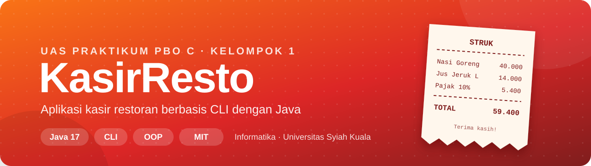

<p align="center">
  
</p>

Aplikasi kasir restoran berbasis CLI (Command Line Interface) menggunakan Java,
dibuat untuk UAS Praktikum Pemrograman Berorientasi Objek (PBO) kelas C.

## Deskripsi Sistem

KasirResto membantu restoran mencatat pesanan dan pembayaran. Ada dua jenis akun:

- Admin: mengelola menu dan akun kasir, melihat riwayat transaksi, dan melihat laporan penjualan.
- Kasir (User): melihat daftar menu, membuat pesanan, memproses pembayaran, dan melihat riwayat transaksinya.

## Fitur

| Admin | Kasir |
|-------|-------|
| Lihat, tambah, edit (termasuk ukuran/pedas), dan hapus menu | Lihat daftar menu (harga Large sudah dihitung) |
| Kelola akun kasir: tambah, hapus, ganti password | Buat pesanan per nomor meja; stok dicek, menu yang sama digabung |
| Riwayat semua transaksi dan rincian struk tiap transaksi | Bayar dengan Tunai, QRIS, atau Debit |
| Laporan harian untuk tanggal pilihan: per metode bayar, per kasir, menu terlaris, stok menipis | Cetak struk, lihat riwayat sendiri, dan cetak ulang struk |

Konsep PBO yang dipakai:

- Abstraction: class abstrak `Akun`, `MenuItem`, dan interface `Pembayaran`
- Inheritance: `Admin` dan `Kasir` turunan `Akun`; `Makanan` dan `Minuman` turunan `MenuItem`
- Polymorphism: `jalankanMenu()`, `hitungHarga()`, dan `bayar()` punya isi berbeda di tiap turunan
- Encapsulation: semua atribut `private` dengan getter dan setter
- Collection: `ArrayList` dan `HashMap` di `DataStore`
- Exception kustom: `LoginGagalException`, `InputTidakValidException`, `StokHabisException`

## Cara Menjalankan

Syarat: Java JDK 17 atau lebih baru. Jalankan dari folder utama repo
(folder yang berisi `src/`).

Cara cepat:

- Windows: klik dua kali `jalankan.bat`, atau ketik `jalankan.bat`
- Linux, macOS, atau Git Bash: `sh jalankan.sh`

Cara manual (berlaku di semua sistem operasi):

```
javac -encoding UTF-8 -d out -sourcepath src src/Main.java
java -cp out Main
```

## Penyimpanan Data

Program menyimpan data ke folder `data/` di folder tempat program dijalankan:

| File | Isi |
|------|-----|
| `data/menu.txt` | daftar menu beserta stok |
| `data/akun.txt` | akun Admin dan Kasir |
| `data/transaksi.txt` | riwayat transaksi beserta item pesanannya |

- Data dimuat saat program dibuka dan disimpan saat program berhenti,
  termasuk saat ditutup paksa (Ctrl+C) atau input habis (Ctrl+D).
- Setiap pembayaran yang berhasil langsung disimpan.
- Hapus folder `data/` untuk kembali ke data awal.
- Folder `data/` tidak ikut di-commit (ada di `.gitignore`).

### Format File Data

Setiap baris berisi satu data, kolomnya dipisah tanda `|`.

`data/menu.txt`

```
Makanan|M01|Nasi Goreng|20000.0|18|true
Minuman|N02|Jus Jeruk|12000.0|19|Large
```

| Kolom | Isi |
|-------|-----|
| 1 | kategori: `Makanan` atau `Minuman` |
| 2 | ID menu |
| 3 | nama menu |
| 4 | harga dasar (tanpa tambahan Large) |
| 5 | stok |
| 6 | Makanan: pedas `true`/`false`; Minuman: ukuran `Regular`/`Large` |

`data/akun.txt`

```
Admin|admin|admin123|Admin Resto
Kasir|kasir|kasir123|Kasir Satu
```

Kolomnya: peran (`Admin`/`Kasir`), username, password, nama lengkap.

`data/transaksi.txt`

Setiap transaksi terdiri dari satu baris `T`, diikuti satu baris `I` untuk setiap item pesanannya.

```
T|T001|2026-11-18T23:59:25|Kasir Satu|Tunai|54000.0|5400.0|59400.0|P001|5|kasir
I|Makanan|M01|Nasi Goreng|20000.0|true|2
I|Minuman|N02|Jus Jeruk|12000.0|Large|1
```

| Baris | Kolom |
|-------|-------|
| `T` | ID transaksi, waktu, nama kasir, metode bayar, subtotal, pajak, total, ID pesanan, nomor meja, username kasir |
| `I` | kategori, ID menu, nama menu, harga dasar, pedas/ukuran, jumlah |

Item transaksi disimpan sebagai salinan, jadi riwayat tidak berubah walaupun menu diedit atau dihapus.
Baris yang rusak dilewati saat program dibuka, dan data lain tetap terbaca.

## Akun untuk Uji Coba

| Peran | Username | Password |
|-------|----------|----------|
| Admin | admin | admin123 |
| Kasir | kasir | kasir123 |

## Panduan Pemakaian

### Admin

Login `admin` / `admin123`, lalu pilih menu:

| No | Menu | Yang bisa dilakukan |
|----|------|---------------------|
| 1 | Lihat Daftar Menu | tabel menu: kategori, keterangan (pedas / ukuran), harga, stok |
| 2 | Tambah Menu | pilih Makanan/Minuman, isi ID (2-4 huruf/angka), nama, harga, stok |
| 3 | Edit Menu | ubah nama, harga, stok, atau ukuran/status pedas |
| 4 | Hapus Menu | hapus menu setelah konfirmasi; riwayat lama tetap aman |
| 5 | Kelola Akun Kasir | lihat, tambah, hapus kasir, dan ganti password kasir |
| 6 | Lihat Riwayat Transaksi | semua transaksi; ketik ID (misalnya `T001`) untuk melihat struknya |
| 7 | Laporan Penjualan Harian | pilih tanggal (Enter = hari ini): total, per metode bayar, per kasir, menu terlaris, stok menipis |

Tips: harga boleh ditulis dengan titik ribuan (`25.000`), dan Enter kosong membatalkan edit atau hapus.

### Kasir

Login `kasir` / `kasir123`, lalu pilih menu:

| No | Menu | Yang bisa dilakukan |
|----|------|---------------------|
| 1 | Lihat Daftar Menu | daftar menu beserta harga dan stok |
| 2 | Buat Pesanan Baru | isi nomor meja, ketik ID menu dan jumlahnya, `0` untuk selesai |
| 3 | Riwayat Transaksi Saya | transaksi milik kasir sendiri; ketik ID untuk cetak ulang struk |

Alur membuat pesanan:

1. Isi nomor meja (`0` untuk batal).
2. Ketik ID menu, misalnya `M01`, lalu jumlahnya. Ketik `M` untuk melihat menu lagi.
3. Ketik `0` jika sudah selesai. Ringkasan pesanan dan total tampil.
4. Pilih metode bayar: `1` Tunai, `2` QRIS, `3` Debit.
5. Untuk Tunai, isi uang yang diterima. Kembalian dan struk tampil.

Contoh struk:

```
  STRUK PEMBAYARAN - KASIR RESTO
============================================
ID Transaksi                            T001
ID Pesanan                              P001
Waktu                    18-11-2026 23:53:21
Kasir                             Kasir Satu
Meja                                       5
--------------------------------------------
Nasi Goreng (Pedas)
  2 x Rp20.000                      Rp40.000
Jus Jeruk (Large)
  1 x Rp14.000                      Rp14.000
--------------------------------------------
Subtotal                            Rp54.000
Pajak (10%)                          Rp5.400
TOTAL                               Rp59.400
--------------------------------------------
Metode Bayar                           Tunai
============================================
   Terima kasih atas kunjungan Anda!
============================================
```

## Struktur Folder

```
src/
├─ model/     Akun, Admin, Kasir, MenuItem, Makanan, Minuman,
│             Pesanan, ItemPesanan, Transaksi
├─ service/   DataStore, AuthService, AkunService, MenuService,
│             PesananService, TransaksiService, LaporanService, FileManager
├─ payment/   Pembayaran (interface), Tunai, Qris, Debit
├─ util/      ConsoleHelper, StrukPrinter, dan exception kustom
└─ Main.java
data/         dibuat otomatis saat program dijalankan (tidak di-commit)
jalankan.bat  skrip compile dan jalankan untuk Windows
jalankan.sh   skrip compile dan jalankan untuk Linux/macOS
assets/       gambar untuk README (cover)
```

## Skenario Uji

Langkah singkat untuk memastikan semua bagian tersambung:

1. Login `kasir` / `kasir123`, pilih 2, isi meja 1, pesan `M01` x2 dan `N02` x1,
   isi `0`, bayar Tunai Rp70.000. Struk dan kembalian tampil.
2. Pilih 3: transaksi tadi muncul di riwayat kasir. Logout.
3. Login `admin` / `admin123`, pilih 1: stok M01 berkurang 2.
4. Pilih 6 dan 7: transaksi muncul di riwayat dan laporan hari ini.
5. Keluar, jalankan lagi, ulangi langkah 4: data masih ada.

## Pembagian Tugas

Pekerjaan dibagi per pasangan. Pembagian di dalam pasangan diatur sendiri oleh kedua anggotanya.

| Pasangan | Anggota | Bagian | File yang dikerjakan |
|----------|---------|--------|----------------------|
| 1 | Muhammad Albharaka Putrosandy (250810701100022)<br>Farras Arthada Siregar (250810701100111) | Fitur Admin: kelola menu, kelola akun kasir, riwayat dan laporan | service/MenuService.java, service/AkunService.java, service/LaporanService.java |
| 2 | M. Dzaky Syraj (250810701100051)<br>Nabil Al Fijar (250810701100031) | Fitur Kasir: pesanan, pembayaran, struk, riwayat kasir | service/PesananService.java, service/TransaksiService.java, payment/*, util/StrukPrinter.java |
| 3 | Mirdha Aulia Zahra (2408107010115)<br>Putroe Zalfa (250810701100024) | Finalisasi: simpan ke file, perbaikan bug, Javadoc, PPT | service/FileManager.java dan seluruh kode |

### Hasil per Pasangan

Pasangan 1 (fitur Admin)

- Tabel menu menampilkan keterangan (pedas / ukuran) dan harga yang benar-benar dibayar
- Tambah, edit, dan hapus menu dengan validasi dan konfirmasi
- Kelola kasir: tambah dengan validasi, hapus dengan konfirmasi, ganti password
- Riwayat semua transaksi dengan rincian struk per ID transaksi
- Laporan harian per metode bayar dan per kasir, menu terlaris, dan stok menipis

Pasangan 2 (fitur Kasir)

- Pesanan per nomor meja: stok dicek, menu yang sama digabung dalam satu baris
- Nomor pesanan dan transaksi melanjutkan riwayat, tidak kembali ke 001
- Pembayaran Tunai (boleh tulis 50.000, uang kurang ditanya ulang), QRIS, dan Debit
- Stok berkurang setelah pembayaran berhasil, pajak dibulatkan ke rupiah
- Struk lengkap, riwayat kasir, dan cetak ulang struk

Pasangan 3 (finalisasi)

- Simpan dan muat menu, akun, dan transaksi ke folder `data/`
- Data tersimpan otomatis saat program berhenti, termasuk Ctrl+C
- Baris data yang rusak dilewati tanpa menghilangkan data lain; akun Admin dibuat ulang jika hilang
- Javadoc lengkap di semua class, skrip `jalankan.bat` / `jalankan.sh`, dan README

## Aturan Kerja Tim

- Satu pasangan mengerjakan file miliknya sendiri. Jangan mengubah file pasangan lain tanpa bilang.
- Nama class, nama method, dan parameter pada kerangka jangan diubah.
- Selalu pakai `ConsoleHelper` untuk input dan tampilan (jangan membuat `Scanner` baru).
- Setiap pasangan bekerja di branch sendiri, lalu `git pull` sebelum `git push`.
- Pesan commit memakai awalan: `feat:`, `fix:`, `docs:`, atau `refactor:`.

## Troubleshooting

`javac` atau `java` tidak dikenali

- Pastikan JDK 17 atau lebih baru sudah terpasang: `javac -version`.
- Di Windows, tambahkan folder `bin` JDK (misalnya `C:\Program Files\Java\jdk-17\bin`) ke PATH, lalu buka ulang terminal.

Data ingin dikembalikan ke awal

- Tutup program, hapus folder `data/`, lalu jalankan lagi. Menu dan akun bawaan akan dipakai.

Tidak bisa login karena akun Admin hilang

- Program otomatis membuat ulang akun `admin` / `admin123` jika tidak ada akun Admin di `data/akun.txt`.

Tabel atau struk terlihat berantakan

- Perlebar jendela terminal (minimal sekitar 65 karakter) dan gunakan font monospace.

`git pull` gagal: `refusing to merge unrelated histories`

- Simpan dulu perubahan yang belum di-commit, lalu samakan dengan GitHub:

```
git fetch origin main
git reset --hard origin/main
```

## Lisensi

Proyek ini dirilis di bawah [MIT License](LICENSE).
